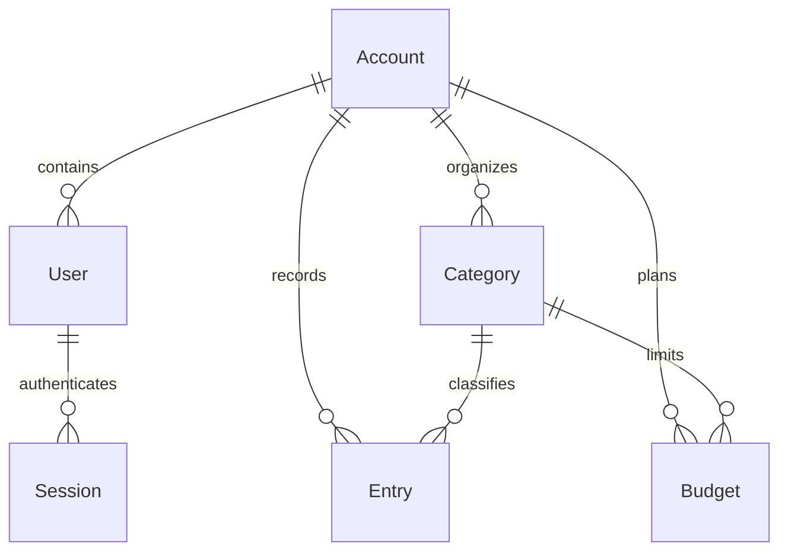

# Architecture and domain decisions

## Requirements

Small businesses need to understand recorded income/expenses, monitor category limits and consolidate CSV data without duplicate records. Owners manage the financial workspace; viewers inspect the same workspace without write access.

Functional requirements: login/logout, monthly reports, categories, immutable transaction values with voiding, monthly category budgets, atomic idempotent CSV imports, filtered paginated history and safe CSV export.

Non-functional requirements: integer-cent values, database integrity constraints, tenant-scoped queries, API authorization, clear errors, responsive UI, automated request/browser tests, documented API and reproducible setup.

## Model

Entry stores description, direction (income/expense), integer amount_cents, occurred_on, external_id and optional voided_at. Amounts are positive; direction determines how they contribute. No transaction edit/delete endpoint exists. Voiding preserves the original amount/reference for traceability; this is not a full accounting audit log or double-entry ledger.

Budgets are unique per account/category/month, with month stored as its first date. Categories are unique per account/name. Database checks enforce positive bounded amounts and valid kinds/roles; foreign keys and unique indexes protect references. Cross-workspace association checks are enforced by the application, not PostgreSQL row-level security.

## Money and dates

Money is bigint cents, never a binary floating point stored amount. CSV strings are validated to at most two decimal places before BigDecimal conversion. The frontend converts decimal strings by splitting whole/fraction parts rather than multiplying a float. Percentages are presentation ratios and may use floating-point division.

Transactions use a date, not a timestamp. ReportingPeriod validates YYYY-MM and restricts report months to years 2000–2100. Month defaults are determined in America/Sao_Paulo. Authentication timestamps remain UTC. An occurred_on date can be in the future; no bank settlement or actual cash balance is inferred.

## Import integrity

1. Validate text size/encoding, exact headers and row count before processing.
2. Acquire the workspace row lock, then validate each row and resolve its category within the same workspace.
3. Look up the external reference in the workspace. Identical payloads are skipped; changed payloads reject the file.
4. Save new records inside one transaction. Any bad row rolls back all changes from this request.
5. Retain the unique (account_id, external_id) database index as the final duplicate guard.

Workspace locks serialize import requests against each other. Imports are bounded to 500 rows/200 KB; background jobs would add infrastructure without a current requirement. Manual entries receive random references. Repeated void requests are idempotent and void status is preserved by import deduplication.

## Reporting and frontend

FinancialReport uses SQL SUM/GROUP BY for monthly direction/category/day aggregates. It fills zero days for the chart. Voided entries are excluded from every aggregate and export, but remain visible as voided in history. Budgets sum expense entries only. Table filters run on the server; page size is 20. Export reuses those filters and caps output at 5,000 active records.

React Router handles views; TanStack Query owns server state. Mutations invalidate summary/history/budget queries. The API serializes explicit fields and returns structured errors. Native modal dialogs supply keyboard focus management and Escape dismissal.

## Authentication and deployment boundaries

BCrypt hashes passwords. A 256-bit random bearer token is returned on login; its SHA-256 digest and 12-hour expiry are persisted. Logout deletes the server-side session. sessionStorage contains the token; it is not a financial-record store. Authorization is checked on every write path; viewers may export but not mutate.

Rate limiting uses process-local memory for a single-process MVP. Production multi-instance hosting needs a shared limiter. Token storage requires XSS prevention; bearer authorization avoids cookie-based CSRF. Password/token fields are filtered from Rails parameters. CSV export prefixes formula-like text cells with an apostrophe.

No penetration test, load test, bank integration or production SLA is claimed. Production needs TLS, managed secrets, backups, monitoring and a retention policy. The process-health endpoint does not check database availability.
